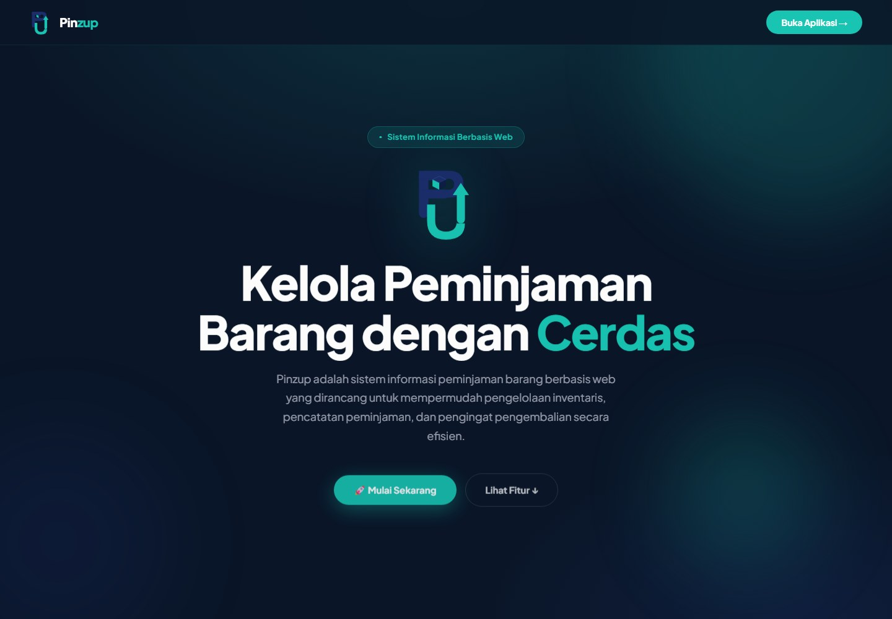

# SISPRALA — Asset Lending System

> Sistem peminjaman sarana prasarana dengan QR per barang, autentikasi scrypt, CSRF protection, denda otomatis, dan audit keamanan tertulis.

**Stack:** Node.js 22 · Express · SQLite · Security

*Screenshot halaman publik [pinzup.asia](https://pinzup.asia/), diambil 25 November 2026 tanpa login atau mengakses data peminjaman. Tampilan deployment bisa berbeda dari source repository.*

## Ringkasan

Sistem peminjaman sarana prasarana dengan QR per barang, autentikasi scrypt, CSRF protection, denda otomatis, dan audit keamanan tertulis.

## Fitur utama

- Login dengan password hashing scrypt
- QR code untuk setiap barang
- Alur pengajuan sampai pengembalian
- Perhitungan denda keterlambatan
- Backup dan restore CSV/JSON
- 21 test end-to-end

## Menjalankan secara lokal

~~~bash
npm install
npm test
npm start
~~~

## Keamanan dan batasan

Ganti secret, akun seed, webhook, CORS, dan konfigurasi cookie sebelum deployment production.

Jangan commit API key, password, token, session ID, data pribadi, atau credential deployment.

## Status

Project portfolio aktif oleh **Hilman Arifin Ilham**. Verifikasi ulang dependency dan konfigurasi sebelum deployment production.

## Lisensi

Belum ada lisensi open-source yang dinyatakan. Hubungi pemilik repository sebelum menggunakan ulang atau mendistribusikan kode.

---

Dibuat oleh [Hilman Arifin Ilham](https://github.com/hilman-devop).
